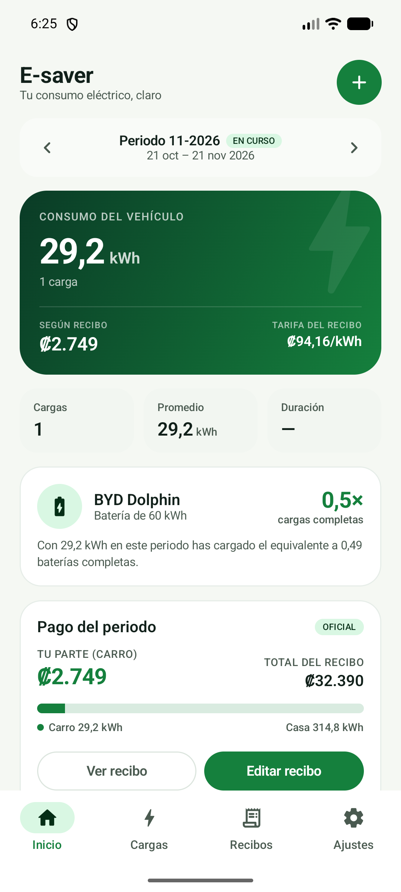
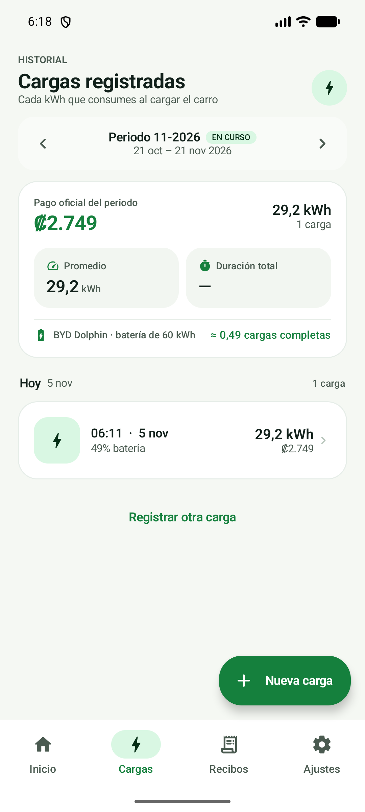
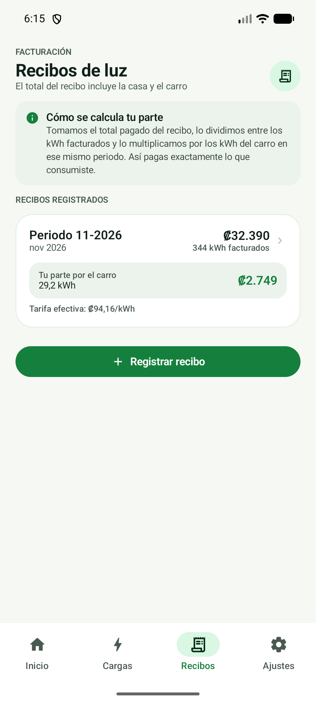
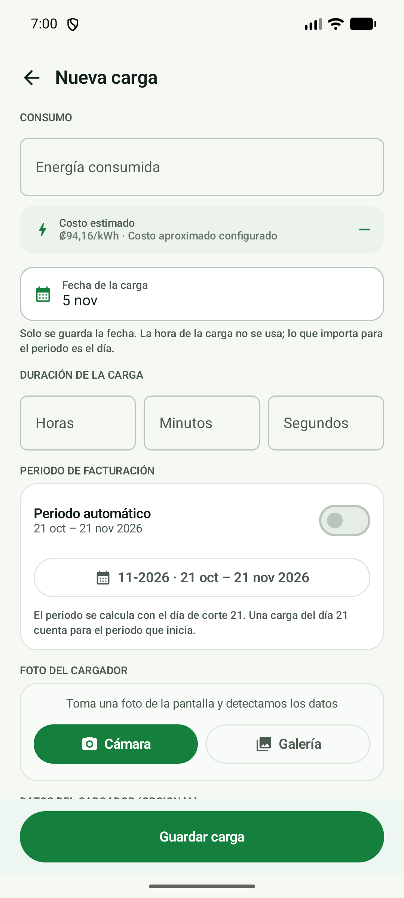
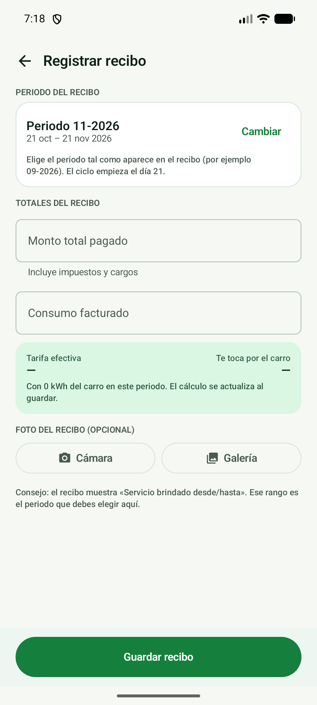

# E-saver

Aplicación Android personal para medir y cobrar el consumo eléctrico del carro.

> Repositorio público: [StevenSanchez/E-saver](https://github.com/StevenSanchez/E-saver)

- **Kotlin + Jetpack Compose** (Material 3).
- **SQLite** local (sin internet, sin cuentas, sin nube).
- **Cámara + OCR on-device**: CameraX, ML Kit y un decodificador propio de
  **7 segmentos** para la cifra grande de kWh.
- **DataStore** para los ajustes y **CameraX** para escanear el cargador.

## Capturas

<table>
  <tr>
    <td align="center"><br><sub>Inicio</sub></td>
    <td align="center"><br><sub>Historial de cargas</sub></td>
    <td align="center"><br><sub>Recibos</sub></td>
  </tr>
  <tr>
    <td align="center"><br><sub>Nueva carga</sub></td>
    <td align="center"><br><sub>Registrar recibo</sub></td>
    <td></td>
  </tr>
</table>

## Tecnologías

| Pieza | Uso |
|---|---|
| Kotlin + Jetpack Compose | Toda la interfaz y la lógica. |
| Material 3 | Tema claro/oscuro y componentes. |
| SQLiteOpenHelper | Dos tablas: `sessions` y `bills`. |
| DataStore Preferences | Ciclo de corte, tarifa, tema y carro. |
| CameraX | Vista previa y captura del cargador. |
| ML Kit (bundled) | Texto de la pantalla, sin conexión. |
| Decodificador 7 segmentos | kWh grande, propio de la app. |
| Navigation Compose | Pestañas, editores y detalle. |

## Qué hace

### 1. Registrar una carga

- Se puede escribir el **kWh** que marca el cargador, la fecha, duración, voltaje,
  corriente y potencia. La hora del día no se guarda: lo que importa para el periodo
  es la fecha y, del cargador, la duración.
- También se puede **tomar una foto de la pantalla** o importarla desde la galería.
  La app intenta detectar `kWh`, tiempo (`04:06:56`), voltaje (`231 V`), corriente
  (`30.7 A`), potencia (`7.1 kW`) y el máximo del cargador (`32 A`).
- Todo queda editable: si el OCR falla, se corrigen los campos a mano.
- Cada carga se puede editar o eliminar después.
- La foto se guarda dentro de la app.

### 2. Periodos de facturación

- El **día de corte** es configurable (por defecto **21**, como el recibo de ejemplo).
- El periodo se etiqueta como el recibo: **09-2026** = del **21 ago** al **21 sep**.
- Las cargas se agrupan por periodo, no por mes calendario. Una carga del **21**
  pertenece al periodo que **inicia** ese día.
- En una carga se puede forzar manualmente el periodo si hace falta.
- Al cambiar el día de corte se recalculan las cargas automáticas; los ajustes
  manuales se conservan.

### 3. Cálculo del pago

- Se registra el recibo: **monto total pagado** y **kWh facturados**.
- La app obtiene la **tarifa efectiva**:

  ```
  tarifa = total pagado ÷ kWh facturados
  tu parte = tarifa × kWh del carro en ese periodo
  ```

- Ejemplo con el recibo de referencia:

  ```
  ₡32.390 ÷ 344 kWh = ₡94,16/kWh
  29,2 kWh del carro × ₡94,16 = ₡2.749
  ```

- Se muestra cuánto corresponde a la casa y cuánto al carro.
- Para registrar un recibo solo se piden el **monto total pagado** y el **consumo
  facturado en kWh** (y el periodo). Los impuestos, bomberos, número de factura,
  medidor y lecturas no se piden porque no afectan el cálculo de tu parte.
- Si todavía no hay recibo, se usa el **costo aproximado por kWh** configurado
  (o el último recibo / promedio de recibos, a elección).

### 4. Carro y batería

- Nombre/modelo del carro y **capacidad de la batería** en kWh.
- Con eso la app muestra:
  - cuántas **cargas completas equivalentes** llevas en el periodo,
  - el **% de batería** de cada carga,
  - el total histórico de cargas completas.

### 5. Historial y respaldo

- Inicio con resumen del periodo, comparación con el periodo anterior y gráfico
  de los últimos 6 periodos.
- Historial de cargas y de recibos, todo editable.
- **Exportar CSV** desde Ajustes (cargas + recibos) para respaldar o compartir.
- Los datos viven solo en el teléfono.

## Arquitectura

El detalle de capas, tablas, ciclo de facturación y pipeline de OCR está en
[docs/ARCHITECTURE.md](docs/ARCHITECTURE.md).

```
MainActivity → ESaverApp (NavHost) → pantallas
                      │
                AppViewModel
        ┌─────────────┼─────────────┐
        ▼             ▼             ▼
  EsaverRepository SettingsStore PhotoStore
        │             │             │
     SQLite        DataStore     files/photos
```

## Abrir el proyecto

1. Abrir **Android Studio**.
2. `File > Open` y elegir la carpeta del proyecto.
3. Esperar la sincronización de Gradle.
4. Ejecutar con el botón **Run** en un teléfono o emulador (Android 8.0 o superior).

El proyecto usa el JDK incluido en Android Studio (`jbr`), Android Gradle Plugin 9.3.2
y Gradle 9.5 (wrapper incluido).

## Compilar el APK

```powershell
# Windows
.\gradlew.bat :app:assembleDebug

# macOS / Linux
./gradlew :app:assembleDebug
```

El APK queda en:

```
app/build/outputs/apk/debug/app-debug.apk
```

### Instalar en el teléfono

Opción A (USB, con depuración activada):

```powershell
adb install -r app/build/outputs/apk/debug/app-debug.apk
```

Opción B: copiar el APK al teléfono y abrirlo, permitiendo “instalar apps
desconocidas” para el explorador de archivos.

## Primeros pasos recomendados

1. **Ajustes > Mi carro**: nombre/modelo y capacidad de batería.
2. **Ajustes > Facturación**:
   - Día de corte: `21` (según el recibo de ejemplo).
   - Costo aproximado por kWh: el que quieras usar para estimar.
   - Base de estimación: Manual / Último recibo / Promedio.
3. Registrar una carga (manual o con foto).
4. Cuando llegue el recibo, entrar a **Recibos > Registrar recibo**, elegir el
   periodo (por ejemplo `09-2026`), poner el total pagado y los kWh facturados.

## Cambios de la versión 1.2

- La cifra grande de kWh se lee con un decodificador propio de 7 segmentos,
  porque ML Kit se saltaba ese número en pantallas de cargador como las del
  ejemplo (22.7 y 24.9 kWh).
- El recorte de la pantalla ahora usa densidad de píxeles blancos/azules, así
  ignora el arco verde, el logo iluminado y los reflejos.
- Si el cargador muestra además el total acumulado (por ejemplo 70.74 kWh), la
  app usa la cifra central de la sesión (24.9 kWh) y no el total.
- Se eliminó la hora de la carga: ahora solo se guarda la fecha (y la duración
  que muestra el cargador).
- El registro de recibos quedó reducido a periodo, monto total y kWh facturados.
  Se quitaron impuestos, bomberos, factura, medidor, lecturas y notas.
- El CSV ya no incluye la columna de hora.

## Notas técnicas

- **Periodo**: `Billing.kt` calcula el ciclo con el día de corte y clamps para
  meses cortos (por ejemplo, día 31 en febrero).
- **Persistencia**: `Db.kt` (SQLiteOpenHelper) con tablas `sessions` y `bills`.
  Un solo recibo por periodo (`UNIQUE(period_key)`).
- **OCR**: `OcrEngine.kt` recorta el LCD por densidad de píxeles, usa ML Kit
  para duración/voltaje/corriente/potencia y un decodificador propio de 7
  segmentos para la cifra grande de kWh. `ChargerOcrParser.kt` interpreta y
  valida los valores con la potencia y la duración. Es una ayuda: siempre se
  puede corregir a mano.
- **Fotos**: se guardan comprimidas en `files/photos/` y se limpian las huérfanas.
- **Cálculos**: `Analytics.kt`; formatos de colones y fechas en `Fmt.kt`.

## Privacidad

No hay servidores, cuentas ni permisos de internet para los datos. La app solo pide
permiso de cámara cuando se usa el escáner. El CSV se genera localmente.
